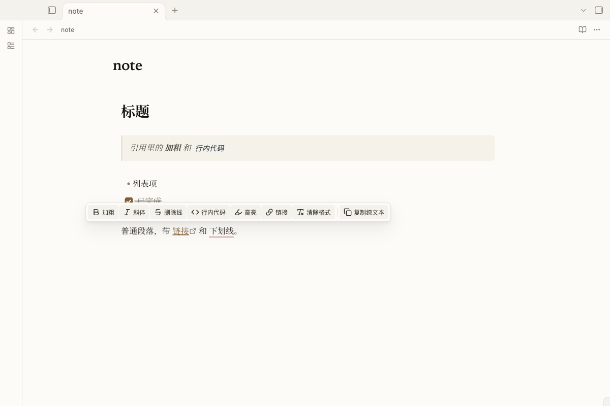
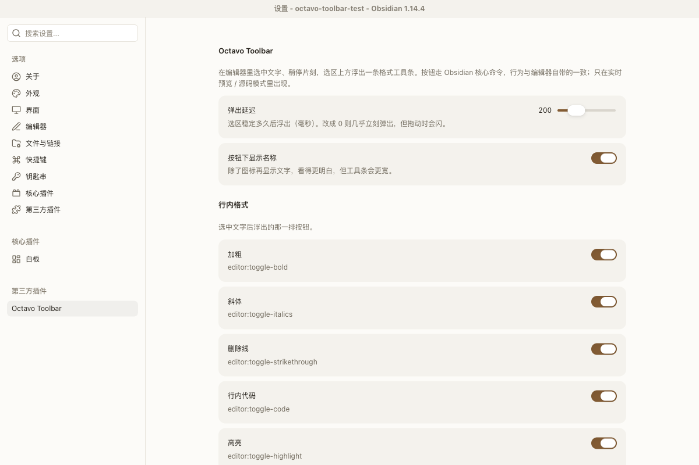

# Octavo Toolbar

English | [简体中文](README.zh-CN.md)

A selection toolbar for Obsidian: select text, pause, and a formatting toolbar appears above the selection. It also includes a configurable **Copy as plain text** action that strips Markdown syntax before writing to the clipboard.

A companion plugin for [Octavo](https://github.com/jiuxianzai/obsidian-theme-octavo), but it works with any theme.



## Features

| Group | Buttons | Default | Behavior |
| --- | --- | --- | --- |
| Inline | Bold, italic, strikethrough, inline code, highlight, link, clear formatting | On | Obsidian core commands such as `editor:toggle-bold` and `editor:insert-link` |
| Inline | Underline (`<u>…</u>`) | Off | Built-in fallback; reuses a compatible marker plugin's command if installed |
| Blocks | H1–H3, bullet list, numbered list, blockquote, code block, task | Off | Core commands such as `editor:set-heading-1` and `editor:toggle-blockquote` |
| Callouts | One **Callout** button that opens a type menu (note, tip, important, warning, caution, example, quote) | Off | Adds, removes, or changes `> [!type]` around the selected block |
| Copy | **Copy as plain text** | On | Filters Markdown syntax according to the settings below |

Button labels are shown by default. You can turn them off in settings for a more compact toolbar.

## Copy as plain text

Select text and click **Copy as plain text** in the toolbar. You can also use:

- Command palette: `Octavo Toolbar: Copy as plain text`
- Editor context menu: **Copy as plain text**
- With no selection, the current line is copied

All filters are enabled by default. You can turn each one off in `Settings → Octavo Toolbar → Copy as plain text`:

| Filter | Removes |
| --- | --- |
| Frontmatter | YAML frontmatter at the top of the note |
| Blockquotes | Leading `>` markers, including nested `> >` |
| Callout headers | `> [!note]`-style headers, keeping the title and body |
| Headings | Leading `#` / `##` … markers |
| Emphasis | `**bold**`, `*italic*`, `~~strikethrough~~`, `==highlight==` markers |
| Code | Backticks and fenced code block markers, keeping the code content |
| Lists | `-`, `1.`, `- [ ]` markers, keeping indentation and text |
| Links / images | `[text](url)` → text; wiki links and aliases → text |
| Tables | Table pipes and the separator row; cells are joined with spaces |
| HTML | `<u>`, `<br>`, `<span>` tags, keeping the text |
| Math | `$…$` / `$$…$$` delimiters, keeping the formula |
| Footnotes | `[^1]` markers and footnote definitions, keeping the note text |
| Horizontal rules | Lines made of `---`, `***`, or `___` |
| Obsidian comments | `%%…%%` comments |

**Example: remove blockquotes only.** Turn off every filter except **Blockquotes**. The leading `>` is removed while `**bold**`, `# headings`, list markers, and other syntax stay as written.

Content inside fenced code blocks and inline code is protected from the inline filters, so code such as `a * b` or `<tag>` is not altered.

## Usage

Select text and pause for about 200 ms (configurable). The toolbar appears above the selection. Press `Esc` or click elsewhere to dismiss it.

The toolbar only appears in Live Preview and Source mode. On mobile, Obsidian already provides a native formatting toolbar, so this plugin is desktop-only.

## Settings

`Settings → Octavo Toolbar`:

- **Popup delay**: how long the selection must be stable before the toolbar appears (0–800 ms).
- **Show button labels**: show text next to icons. Enabled by default.
- **Per-button toggles**: inline, block, callout, and copy groups.
- **Copy as plain text**: 14 filters, all enabled by default.



## Installation

### From the Community plugins directory (after approval)

`Settings → Community plugins → Browse`, search for **Octavo Toolbar**, install, and enable it.

### Manual installation

```
<vault>/.obsidian/plugins/octavo-toolbar/
├── main.js
├── manifest.json
└── styles.css
```

Place the whole `octavo-toolbar` folder in the path above, restart Obsidian (or reload it from `Settings → Community plugins`), then enable the plugin.

## Compatibility and privacy

- Obsidian **1.5.0+**, desktop only (`isDesktopOnly: true`).
- No network requests, telemetry, ads, or self-updates.
- Reads the current editor selection and writes to the system clipboard. It does not access files outside the active editor.
- Works with any theme. The plugin ships its own `styles.css` and uses Octavo theme variables when available.

## Development

There is no build step. `main.js` and `styles.css` are the source and the final artifacts. `manifest.json` contains the plugin metadata, and `versions.json` maps releases to the minimum Obsidian version.

## License

[MIT](LICENSE).
